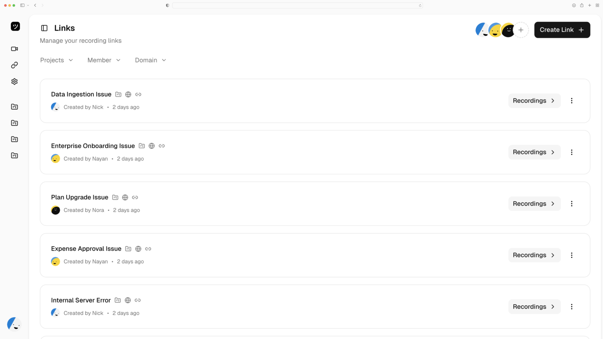
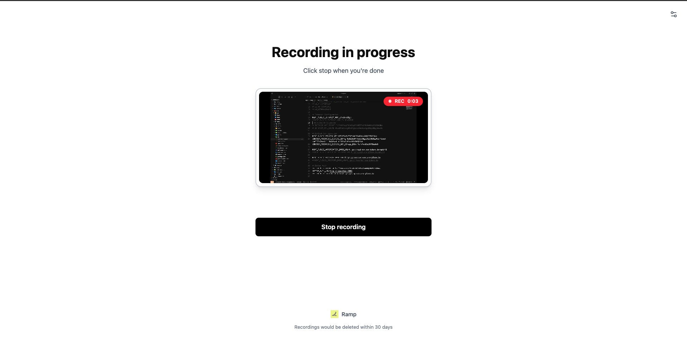
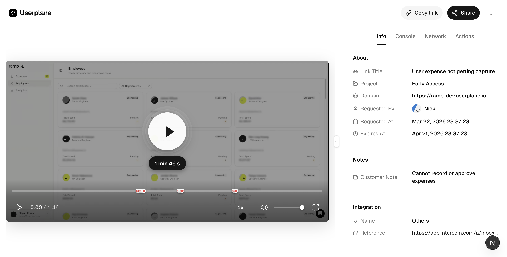
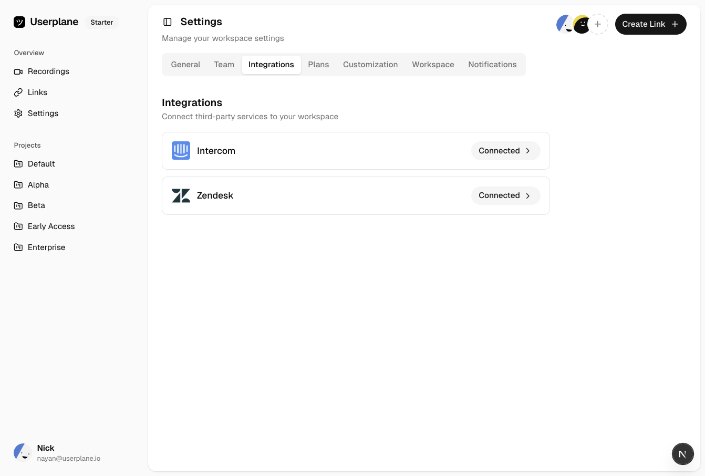
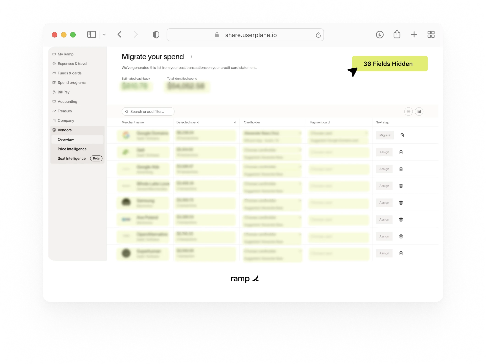
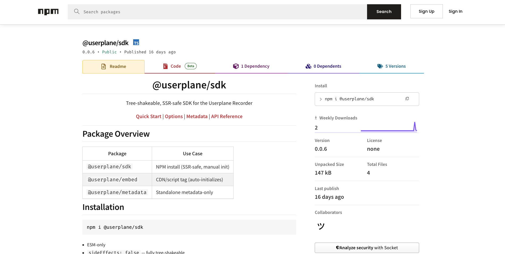
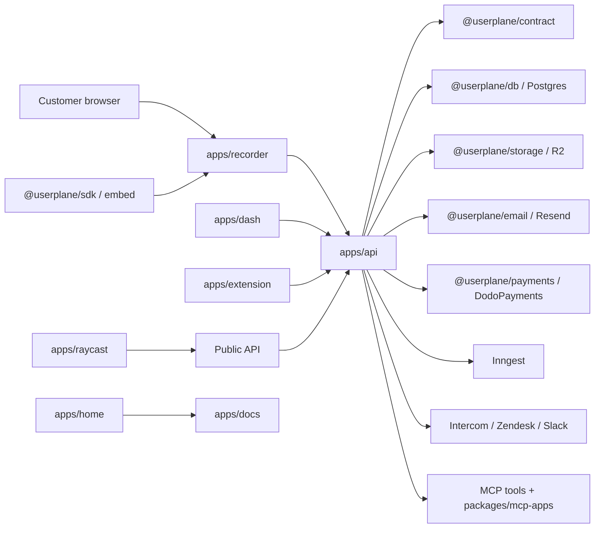

<div align="center">
  <p>
    
  </p>

  <h1>Userplane</h1>

  <p><strong>The open-source Loom alternative built for customer support.</strong></p>

  <p>
    Send customers one recording link. Get back the replay, console logs,
    network requests, user actions, notes, metadata, and session details your
    team needs to resolve issues without the back-and-forth.
  </p>

  <p>
    <a href="https://userplane.io"><strong>Website</strong></a>
    |
    <a href="https://dash.userplane.io"><strong>Dashboard</strong></a>
    |
    <a href="https://docs.userplane.io"><strong>Docs</strong></a>
    |
    <a href="https://userplane.io/demo"><strong>Demo</strong></a>
    |
    <a href="https://docs.userplane.io/api/introduction"><strong>API Reference</strong></a>
    |
    <a href="#contributing"><strong>Contributing</strong></a>
  </p>
</div>



> Loom is great for async video. Userplane is for customer issues: a
> support-native recording workflow that turns hard-to-describe bugs into debug-ready
> evidence.

## Table Of Contents

- [Open-Source Loom Alternative For Customer Support](#open-source-loom-alternative-for-customer-support)
- [Why This Exists](#why-this-exists)
- [The Information Gap In Support](#the-information-gap-in-support)
- [Why Support Needs More Than Video](#why-support-needs-more-than-video)
- [How Userplane Compares](#how-userplane-compares)
- [How Userplane Works](#how-userplane-works)
- [What Comes Back With A Recording](#what-comes-back-with-a-recording)
- [Built For Every Team That Touches Support](#built-for-every-team-that-touches-support)
- [Support Workflows And Integrations](#support-workflows-and-integrations)
- [Privacy, Control, And Trust](#privacy-control-and-trust)
- [Developer Platform And AI Debugging](#developer-platform-and-ai-debugging)
- [What Lives In This Repo](#what-lives-in-this-repo)
- [Product Surfaces](#product-surfaces)
- [Architecture](#architecture)
- [Getting Started](#getting-started)
- [Common Commands](#common-commands)
- [Environment And Services](#environment-and-services)
- [Documentation Map](#documentation-map)
- [Reader Paths](#reader-paths)
- [Contributing](#contributing)
- [Security](#security)
- [License](#license)

## Open-Source Loom Alternative For Customer Support

If Loom is async video for your team, Userplane is async issue capture for your
customers.

It is built for the moment when a ticket says "it broke", but the team needs to
know what page the customer was on, what they clicked, which request failed,
what the console said, which account or workspace was involved, and whether the
same issue can be reproduced.

Userplane gives support teams the easiest possible ask: "Can you record what
you are seeing?" The customer opens a link, records in the browser, and submits.
Your team gets the video plus the technical context that usually takes several
messages, screenshots, calls, and escalations to collect.

The result is a cleaner support artifact: the issue as the customer experienced
it, with enough evidence for support, success, and engineering to decide what to
do next.

## Why This Exists

We ran into this problem repeatedly while running a previous startup. A customer
would hit a bug, support would ask for steps, success would ask for a screenshot,
engineering would ask for console output, and by the time everyone had enough
context the customer had explained the same problem three different ways.

The problem was not effort. It was the artifact. A written ticket cannot
reliably carry visual state, browser state, failed requests, user actions,
account context, and what the customer expected to happen.

Userplane is the artifact we wished we had: one link for the customer, one
recording for the team, and one place where the video, logs, network activity,
metadata, and support reference stay together.

## The Information Gap In Support

Support is usually treated like a response problem: answer faster, write better
macros, hire more agents, add another queue. But the hardest support tickets are
often information problems.

The customer has the full experience, but compresses it into a sentence like
"export is broken." Support receives that sentence without the sequence,
environment, browser state, account state, failed request, console output, or
customer expectation behind it. Engineering then receives an even thinner
version of the same story and tries to reproduce the issue from memory,
screenshots, and guesses.

That is how tickets turn into long threads. Customers repeat themselves.
Support asks broad clarifying questions because it cannot see what happened.
Engineers mark issues as not reproducible because the conditions that produced
the bug never made it into the handoff.

Userplane captures the missing information at the moment it exists: when the
customer is experiencing the issue. The customer does not need to know what
details matter. They show the problem, and Userplane turns that moment into a
debug-ready artifact your team can replay, inspect, and share.

## Why Support Needs More Than Video

Video is valuable because it shows the symptom. For customer support, the unlock
is the context behind the symptom.

Most screen recording tools assume the recorder is someone inside your company:
a teammate making a walkthrough, a sales rep recording a demo, or an engineer
documenting a bug. Customer support is different. The recorder is a customer who
may be in another timezone, already frustrated, and unsure which details matter.

That gap is where tickets stall. Support waits for the next customer reply.
Customers wait for the next business day. Engineers wait for a reproducible
case. Nobody is trying to slow the work down, but the context arrives in pieces.

Userplane is designed around that reality. It does not ask customers to become
QA analysts. It lets them show the issue, then captures the context your team
needs around that moment.

| The support problem                                      | A normal screen recording gives you | Userplane gives you                                                                 |
| -------------------------------------------------------- | ----------------------------------- | ----------------------------------------------------------------------------------- |
| The customer cannot describe the issue clearly.          | A video, if they know what to show. | A one-click recording link made for customer issue reporting.                       |
| Support needs screenshots, steps, browser data, and IDs. | More follow-up questions.           | Replay, notes, browser context, link references, project, domain, and metadata.     |
| Engineers need to know what failed.                      | A visual clue.                      | Console logs, network requests, user actions, and timestamped debugging evidence.   |
| The ticket moves between tools and teams.                | Scattered links and attachments.    | A structured recording tied to workspace, project, domain, customer, and ticket.    |
| The recording may contain sensitive information.         | Manual cleanup or risky sharing.    | Blur rules, capture controls, workspace access, sharing controls, and expiry rules. |

The ticket stops being a description of the bug and becomes something your team
can replay, inspect, share, and debug.

## How Userplane Compares

Userplane is not trying to replace every tool near the support stack. It sits in
a specific category: customer-initiated, async issue capture with technical
context attached.

| Category                     | Built for                                                      | Where it falls short for support                                                                   | Where Userplane fits                                                                   |
| ---------------------------- | -------------------------------------------------------------- | -------------------------------------------------------------------------------------------------- | -------------------------------------------------------------------------------------- |
| Loom / generic recording     | Async video, walkthroughs, internal communication              | Video only; no console logs, network requests, browser/session metadata, or support structure      | Customer-to-team issue capture with technical context attached                         |
| Session replay               | Passive product replay, UX research, historical analysis       | Hard to find the exact session; product-bound; often lacks customer narration and external context | Customer points directly to the issue and records what matters                         |
| Developer bug tools          | QA, engineering, technical reporters, Jira or Linear workflows | Assumes the reporter understands technical concepts and often starts in engineering tools          | Non-technical customers record from a simple support-native flow                       |
| Support-platform video       | Broad helpdesk coverage, live calls, screen share add-ons      | Often synchronous, generic, and light on debugging context                                         | Async diagnostic capture that fits into support workflows                              |
| Screenshots                  | Static visual bugs and quick annotations                       | Misses sequence, timing, user actions, and what led to the state                                   | Captures the full path to the issue, not just the final frame                          |
| APM / error monitoring       | Exceptions, backend errors, stack traces, performance signals  | Shows code-level failure, not always the customer-visible experience or intent                     | Connects what the customer saw with browser-side signals and actions                   |
| Co-browsing / remote desktop | Live guidance, handholding, or taking action on a machine      | Requires scheduling, customer presence, and one-to-one agent time                                  | Async diagnosis when the team needs to understand, not control, the customer's machine |
| Impersonation                | Inspecting current account state and configuration             | Cannot show what happened earlier, the customer's browser, timing, or external context             | Captures the sequence from the customer's actual environment                           |

The pattern is simple: adjacent tools explain, monitor, aggregate, guide, or
inspect. Userplane is for the moment a customer says something broke and your
team needs to see what happened, what failed, and what context belongs with the
ticket.

## How Userplane Works

### 1. Create A Recording Link


Create a recording link from the dashboard, API, Chrome extension, Raycast,
Intercom, Zendesk, Slack, or another support workflow. Choose the project and
domain, add a ticket or customer reference, decide whether the link is
single-use or reusable, and send it to the customer.

This keeps the ask lightweight for the customer and structured for your team.
The link already knows where the recording belongs.

### 2. The Customer Records In Browser



The customer opens the link and records the issue in their browser. No account,
app install, or browser extension is required for the customer. They can show
exactly what went wrong, add notes, and submit.

They do not need to know whether the console matters, which network call failed,
or what metadata your team needs. Userplane captures the surrounding technical
context automatically.

### 3. Your Team Reviews The Replay



The recording lands in Userplane with the video and debugging context attached.
Support can see the issue through the customer's lens, engineering can inspect
the technical signals, and everyone can work from the same evidence instead of
reconstructing the issue from a ticket transcript.

## What Comes Back With A Recording

Userplane turns a customer report into a compact case file. A recording can
include the surrounding session context that makes the issue understandable and
actionable.

| Context          | Why it matters                                                                               |
| ---------------- | -------------------------------------------------------------------------------------------- |
| Screen video     | See the exact user journey and visual state.                                                 |
| Console logs     | Catch JavaScript errors, warnings, and debug output.                                         |
| Network requests | Inspect failed requests, status codes, timings, and API behavior.                            |
| User actions     | Follow clicks, inputs, scrolls, navigation, and interaction order.                           |
| Notes            | Let the customer explain what they expected or what felt wrong.                              |
| System metadata  | Understand browser, OS, page URL, link, project, domain, and workspace context.              |
| Custom metadata  | Attach user IDs, account IDs, plan, flags, app version, route, or any app state you provide. |

The goal is simple: complete context upfront. Support should not have to chase a
customer for details. Engineering should not have to guess from a screenshot.
Customers should not have to explain what they do not have the language to
describe.

## Built For Every Team That Touches Support

Userplane is built for the people who pass customer issues between support,
success, and engineering.

| Team               | What they need                                                      | How Userplane helps                                                                                                  |
| ------------------ | ------------------------------------------------------------------- | -------------------------------------------------------------------------------------------------------------------- |
| Support agents     | Understand what went wrong without endless follow-up.               | Request a recording, watch the replay, review user actions, and keep the ticket moving with full context attached.   |
| Support engineers  | Get to the root cause on the first look.                            | Inspect console logs, network requests, runtime context, metadata, and the exact sequence that led to the issue.     |
| Customer success   | Resolve harder-to-describe issues without forcing a live call.      | Let customers show what happened asynchronously, then keep recordings tied to accounts, workspaces, and references.  |
| Engineering teams  | Reproduce customer-reported bugs with evidence instead of folklore. | Install the SDK, attach app metadata, configure redaction, and receive replayable, engineer-ready artifacts.         |
| Support operations | Keep customer debugging artifacts controlled and discoverable.      | Organize recordings by workspace, project, domain, link, creator, status, expiry, and connected support workflow.    |
| AI and automation  | Analyze real customer sessions with permissioned context.           | Use the public API and MCP tools to inspect recordings, pull logs, review actions, and summarize likely root causes. |

## Support Workflows And Integrations



Userplane is designed to live where support already happens.

- Request recordings from the dashboard when you are triaging a workspace.
- Use the Chrome extension beside any support tool.
- Create and inspect links from Raycast without leaving the keyboard.
- Connect Intercom, Zendesk, and Slack workflows so recordings stay close to
  customer conversations and ticket references.
- Use the API when you want links to be created by your own product, backend, or
  automation.

That means a recording request can start from the place the problem was reported
and come back to the place the team is already working.

## Privacy, Control, And Trust



Recording customer sessions is powerful, so the capture surface needs controls.
Userplane includes workspace, domain, project, link, sharing, retention, and
capture preferences that help teams collect useful context without collecting
everything.

- Configure what a domain is allowed to capture.
- Blur sensitive fields and reduce unnecessary exposure.
- Manage workspace membership, roles, access policies, and share behavior.
- Keep recordings organized by project, link, domain, creator, status, and
  expiry.
- Centralize recordings instead of letting screenshots, videos, and debugging
  artifacts scatter across tickets, email, and chat.

## Developer Platform And AI Debugging


Userplane is also a developer platform. Teams can wire recording links into the
product, attach app metadata, call the public API, and expose recordings to AI
clients through MCP.



Developer surfaces include:

- A CDN embed script for fast installation.
- `@userplane/sdk` for programmatic initialization, recorder control, state
  inspection, and metadata.
- `@userplane/metadata` for standalone metadata capture.
- Public API endpoints for workspaces, projects, domains, links, recordings,
  resources, and account data.
- OpenAPI and Postman artifacts in the docs app.
- Userplane MCP at `https://api.userplane.io/mcp` for authenticated workspace
  tools.
- Documentation MCP at `https://docs.userplane.io/mcp` for inline integration
  help.

## What Lives In This Repo

This repository contains the full Userplane product system: the API, dashboard,
customer recorder, public docs, marketing site, Chrome extension, Raycast
extension, demo app, SDKs, shared UI, storage/media utilities, database schema,
contracts, MCP widgets, billing, auth, email, and integration packaging.

If you are here to understand the product, start above. If you are here to work
on the codebase, the rest of this README maps the monorepo.

```text
userplane/
|-- apps/
|   |-- api/        # Hono API, public API, auth, integrations, MCP, jobs
|   |-- dash/       # Main workspace dashboard
|   |-- docs/       # Mintlify public documentation
|   |-- extension/  # Chrome extension built with WXT
|   |-- home/       # Astro marketing site and generated markdown/OG surfaces
|   |-- ramp/       # Demo app for SDK and support workflow testing
|   |-- raycast/    # Raycast extension
|   `-- recorder/   # Customer-facing recording runtime
|-- packages/
|   |-- contract/   # oRPC contracts, Zod schemas, OpenAPI/MCP generation
|   |-- client/     # Typed API client
|   |-- db/         # Drizzle schema, migrations, database client
|   |-- sdk/        # Browser recorder SDK
|   |-- embed/      # CDN/embed wrapper around the SDK
|   |-- metadata/   # Standalone metadata registry
|   |-- logger/     # Browser capture logger
|   |-- blurr/      # Privacy blur system
|   |-- postbridge/ # Typed postMessage/RPC bridge
|   |-- ui/         # Shared UI primitives and styling
|   `-- ...         # Auth, storage, payments, email, pricing, cache, tooling
|-- developers/     # Contributor setup guides and area-specific guides
|-- assets/         # Repo-level media, including README-owned visuals
|-- scripts/        # Repo maintenance scripts
`-- .github/        # Issues, PR template, security policy, workflows
```

For the full runnable-app index, see [apps/README.md](apps/README.md). For the
full shared-package index, see [packages/README.md](packages/README.md).

## Product Surfaces

| Surface          | Path                                             | Purpose                                                                                      | Stack                                     | Local command                                | Port   | Guide                                             |
| ---------------- | ------------------------------------------------ | -------------------------------------------------------------------------------------------- | ----------------------------------------- | -------------------------------------------- | ------ | ------------------------------------------------- |
| API              | [apps/api](apps/api/README.md)                   | Auth, workspaces, recordings, links, billing, integrations, public API, MCP, background jobs | Bun, Hono, oRPC, Drizzle, Inngest         | `make dev:api`                               | `3001` | [API guide](developers/guides/api.md)             |
| Dashboard        | [apps/dash](apps/dash/README.md)                 | Workspace UI, links, recordings, playback, settings, billing, integrations, admin            | Next.js, React, TanStack Query            | `make dev:dash`                              | `3000` | [Dashboard guide](developers/guides/dashboard.md) |
| Recorder         | [apps/recorder](apps/recorder/README.md)         | Customer-facing recorder runtime, domain verification, hidden capture surface                | Next.js, React, MediaRecorder, PostBridge | `make dev:recorder`                          | `4322` | [Recorder guide](developers/guides/recorder.md)   |
| Docs             | [apps/docs](apps/docs/README.md)                 | Public docs, API reference, integration guides, OpenAPI, ChatGPT app submission artifact     | Mintlify, MDX                             | `make dev:docs`                              | `3005` | [Docs guide](developers/guides/docs.md)           |
| Home             | [apps/home](apps/home/README.md)                 | Marketing site, pricing, blog, framework pages, integration pages, OG images, `llms.txt`     | Astro, React islands, Tailwind, Satori    | `make dev:home`                              | `4321` | [Home guide](developers/guides/home.md)           |
| Chrome extension | [apps/extension](apps/extension/README.md)       | Side panel, create links, browse recordings, settings, context menus, omnibox                | WXT, React, TanStack Router/Query         | `make dev:extension`                         | `3010` | [Extension guide](developers/guides/extension.md) |
| Raycast          | [apps/raycast](apps/raycast/README.md)           | Create links, browse recordings/links, menu bar workflows from Raycast                       | Raycast API, TypeScript                   | `make raycast:dev`                           | n/a    | [Raycast guide](developers/guides/raycast.md)     |
| Ramp demo        | [apps/ramp](apps/ramp/README.md)                 | Realistic demo app for exercising the SDK, metadata, support widgets, and recording links    | Next.js, React, Drizzle/libSQL            | `make dev:ramp`                              | `3002` | [Ramp guide](developers/guides/ramp.md)           |
| MCP apps         | [packages/mcp-apps](packages/mcp-apps/README.md) | Single-file React widgets rendered by MCP tool results                                       | Vite, React, Apps SDK                     | `bun run --filter @userplane/mcp-apps build` | n/a    | [MCP guide](developers/guides/mcp.md)             |

## Architecture



### Request And Data Flow

1. A client uses `@userplane/client`, the public API, or a direct app route.
2. Shared contracts in `@userplane/contract` define request and response shapes.
3. API routes in `apps/api` validate the request and call a service.
4. Services call repositories, storage clients, email clients, billing clients,
   integration clients, or Inngest.
5. Data is persisted in Postgres via `@userplane/db` and media/log artifacts are
   stored through `@userplane/storage`.

### Recording Flow

1. A link is created with workspace, project, domain, reference, and reuse
   settings.
2. The customer opens a `userplane-action=recording` link with a signed token.
3. The SDK/embed or recorder runtime validates the token and opens the recorder.
4. The recorder captures screen/audio and coordinates browser context through
   PostBridge, logger, metadata, and blur packages.
5. Uploads complete through API session endpoints and storage presigned URLs.
6. The dashboard, API, MCP tools, and integrations review the recording and its
   related logs, actions, requests, notes, and metadata.

## Getting Started

### Prerequisites

| Tool or service | Version / note                                                                                    |
| --------------- | ------------------------------------------------------------------------------------------------- |
| Node.js         | `24.14.1` locally, root engine `>=24.0.0 <25.0.0`                                                 |
| Bun             | `1.3.13`                                                                                          |
| PostgreSQL      | Managed Postgres via [Neon](developers/setup/neon.md) or [Supabase](developers/setup/supabase.md) |
| cloudflared     | Needed for OAuth callbacks, webhooks, and integration testing                                     |

### Quickstart

```bash
git clone https://github.com/wizenheimer/userplane.git
cd userplane
make install
make env:setup
# edit apps/api/.env.development and set DATABASE_URL
make db:push
make dev
```

`make dev` starts the core local apps. Use focused commands when working on one
surface at a time.

## Common Commands

### Setup

| Command          | Purpose                                              |
| ---------------- | ---------------------------------------------------- |
| `make install`   | Install all dependencies                             |
| `make update`    | Update dependencies                                  |
| `make env:setup` | Copy `.env.example` files into development env files |
| `make env:check` | Verify expected development env files exist          |

### Development

| Command              | Purpose                                     |
| -------------------- | ------------------------------------------- |
| `make dev`           | Run the core apps                           |
| `make dev:extras`    | Run all apps including docs and extension   |
| `make dev:api`       | Run API only                                |
| `make dev:dash`      | Run dashboard only                          |
| `make dev:home`      | Run home/marketing site only                |
| `make dev:docs`      | Run Mintlify docs only                      |
| `make dev:recorder`  | Run recorder only                           |
| `make dev:extension` | Run Chrome extension dev server             |
| `make dev:ramp`      | Run Ramp demo app only                      |
| `make dev:sdk`       | Run SDK-focused toolchain plus related apps |

### Quality

| Command             | Purpose                                |
| ------------------- | -------------------------------------- |
| `make lint`         | Run linters                            |
| `make lint:fix`     | Run linters and apply fixes            |
| `make format`       | Format supported files                 |
| `make format:check` | Check formatting                       |
| `make typecheck`    | Type-check all packages/apps           |
| `make check`        | Run lint, typecheck, and format checks |
| `make fix`          | Run lint fixes and formatting          |
| `make test`         | Run available tests                    |

### Database

| Command                | Purpose                                           |
| ---------------------- | ------------------------------------------------- |
| `make db:generate`     | Generate Drizzle migrations for the main database |
| `make db:migrate`      | Apply pending main database migrations            |
| `make db:push`         | Push schema directly in development               |
| `make db:studio`       | Open Drizzle Studio                               |
| `make ramp:db:migrate` | Run Ramp demo database migrations                 |
| `make ramp:db:seed`    | Seed Ramp demo data                               |
| `make ramp:db:studio`  | Open Drizzle Studio for Ramp                      |

### Docs, Codegen, Assets

| Command                                | Purpose                                      |
| -------------------------------------- | -------------------------------------------- |
| `make generate:openapi`                | Generate OpenAPI spec for docs/API reference |
| `make generate:chatgpt-app-submission` | Generate ChatGPT app submission artifact     |
| `make docs:check`                      | Validate Mintlify docs                       |
| `make assets:upload:dry-run`           | Preview R2 asset uploads                     |
| `make assets:validate`                 | Validate local and remote assets             |
| `make assets:optimize:dry-run`         | Preview image optimization savings           |

### Integrations And Release Helpers

| Command                     | Purpose                                     |
| --------------------------- | ------------------------------------------- |
| `make tunnel:start`         | Start Cloudflare tunnels for local services |
| `make tunnel:status`        | Show tunnel status and URLs                 |
| `make inngest:dev`          | Run Inngest dev server                      |
| `make extension:build`      | Build Chrome extension                      |
| `make extension:zip`        | Zip Chrome extension                        |
| `make raycast:dev`          | Run Raycast extension locally               |
| `make raycast:prepublish`   | Prepare Raycast Store package lock          |
| `make package:zendesk`      | Package Zendesk manifest for development    |
| `make package:zendesk:prod` | Package Zendesk manifest for production     |

## Environment And Services

Run `make env:setup` first. Each app/package owns its own `.env.example`, and
the generated development files should be edited only for the services you need.

| Service                   | Needed for                                           | Guide                                                                      |
| ------------------------- | ---------------------------------------------------- | -------------------------------------------------------------------------- |
| Neon or Supabase Postgres | API, dashboard, recorder, integrations               | [Neon](developers/setup/neon.md), [Supabase](developers/setup/supabase.md) |
| Cloudflare Tunnels        | OAuth callbacks, webhooks, local integration testing | [Cloudflare Tunnels](developers/setup/cloudflare-tunnels.md)               |
| Upstash Redis             | Cache and rate limiting                              | [Upstash](developers/setup/upstash.md)                                     |
| Inngest                   | Background jobs                                      | [Inngest](developers/setup/inngest.md)                                     |
| DodoPayments              | Billing and subscriptions                            | [DodoPayments](developers/setup/dodopayments.md)                           |
| Resend                    | Transactional email                                  | [Resend](developers/setup/resend.md)                                       |
| PostHog                   | Analytics and client/server telemetry                | [PostHog](developers/setup/posthog.md)                                     |
| Unkey                     | API key management                                   | [Unkey](developers/setup/unkey.md)                                         |
| Google OAuth              | Authentication                                       | [Google OAuth](developers/setup/google-oauth.md)                           |
| Cloudflare R2             | Recordings, screenshots, media assets                | [Cloudflare R2](developers/setup/cloudflare-r2.md)                         |
| Intercom                  | Intercom app and OAuth integration                   | [Intercom App](developers/setup/intercom-app.md)                           |
| Zendesk                   | Zendesk app and OAuth integration                    | [Zendesk App](developers/setup/zendesk-app.md)                             |
| Slack                     | Slack app and commands                               | [Slack App](developers/setup/slack-app.md)                                 |

## Documentation Map

| Documentation    | Path or URL                                            | Purpose                                              |
| ---------------- | ------------------------------------------------------ | ---------------------------------------------------- |
| Public docs      | [https://docs.userplane.io](https://docs.userplane.io) | User-facing guides, API docs, integrations, SDK docs |
| Docs source      | [apps/docs](apps/docs/README.md)                       | Mintlify source, media references, OpenAPI reference |
| Contributor docs | [developers](developers/README.md)                     | Local setup and area-specific contribution guides    |
| App index        | [apps/README.md](apps/README.md)                       | Detailed map of runnable apps                        |
| Package index    | [packages/README.md](packages/README.md)               | Detailed map of shared packages                      |
| README media     | [assets/readme](assets/readme/README.md)               | Source mapping for root README visuals               |
| Contributing     | [CONTRIBUTING.md](CONTRIBUTING.md)                     | Branching, commits, PR expectations                  |
| Security         | [.github/SECURITY.md](.github/SECURITY.md)             | Vulnerability reporting                              |

## Reader Paths

| If you are...                   | Start here                                                                                                                                                                                                                    | Then go deeper                                                                                                                     |
| ------------------------------- | ----------------------------------------------------------------------------------------------------------------------------------------------------------------------------------------------------------------------------- | ---------------------------------------------------------------------------------------------------------------------------------- |
| Evaluating Userplane            | [Open-Source Loom Alternative For Customer Support](#open-source-loom-alternative-for-customer-support), [The Information Gap In Support](#the-information-gap-in-support), [How Userplane Compares](#how-userplane-compares) | [Docs](https://docs.userplane.io), [Demo](https://userplane.io/demo)                                                               |
| Integrating the SDK             | [Developer Platform And AI Debugging](#developer-platform-and-ai-debugging)                                                                                                                                                   | [packages/sdk](packages/sdk/README.md), [packages/embed](packages/embed/README.md), [apps/docs/developer](apps/docs/developer)     |
| Contributing to the app         | [Getting Started](#getting-started), [Common Commands](#common-commands)                                                                                                                                                      | [CONTRIBUTING.md](CONTRIBUTING.md), [developers/README.md](developers/README.md)                                                   |
| Working on API/data             | [Architecture](#architecture), [Product Surfaces](#product-surfaces)                                                                                                                                                          | [apps/api](apps/api/README.md), [packages/contract](packages/contract/README.md), [packages/db](packages/db/README.md)             |
| Working on recording capture    | [How Userplane Works](#how-userplane-works), [Developer Platform And AI Debugging](#developer-platform-and-ai-debugging)                                                                                                      | [apps/recorder](apps/recorder/README.md), [packages/sdk](packages/sdk/README.md), [packages/logger](packages/logger/README.md)     |
| Working on support integrations | [Support Workflows And Integrations](#support-workflows-and-integrations), [Environment And Services](#environment-and-services)                                                                                              | [apps/extension](apps/extension/README.md), [apps/raycast](apps/raycast/README.md), [packages/zendesk](packages/zendesk/README.md) |
| Maintaining docs or media       | [Documentation Map](#documentation-map)                                                                                                                                                                                       | [apps/docs](apps/docs/README.md), [apps/home](apps/home/README.md), [assets/readme](assets/readme/README.md)                       |

## Contributing

Start with [CONTRIBUTING.md](CONTRIBUTING.md) and
[developers/README.md](developers/README.md).

The short version:

1. Branch from `main`.
2. Use a conventional branch name like `feat/add-slack-notifications`.
3. Use conventional commits like `feat(api): add workspace member role filtering`.
4. Run `make check` before opening a PR.
5. Include screenshots for UI changes and docs updates for behavior changes.

## Security

Please do not open public issues for vulnerabilities. Follow
[.github/SECURITY.md](.github/SECURITY.md) for reporting instructions and
supported scope.

## License

Userplane uses Apache-2.0 at the repository root, with workspace-specific
FSL-1.1-ALv2 exceptions declared in each app/package `LICENSE.md`.
